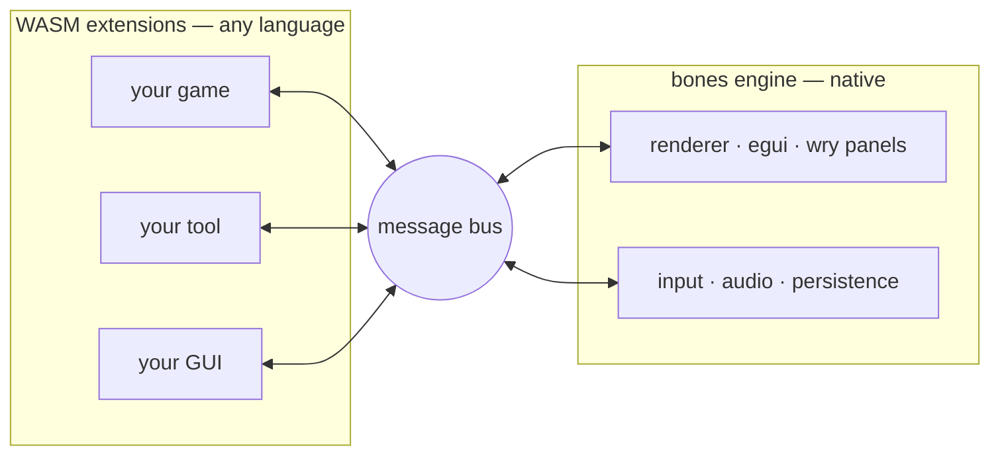

<div align="center">

# bones

**A small native engine core. Everything else is a WASM extension, in any language.**

[](https://github.com/an-dr/bones/actions/workflows/ci.yml) [](CHANGELOG.md) [](wit/README.md) [](LICENSE) [](https://ai-level.dev/level-3)

[How to use it](#how-to-use-bones) · [Release archives](#release-archives) · [Examples](examples/README.md) · [Documentation](docs/index.md) · [Changelog](CHANGELOG.md)

</div>

---

The core owns windows, the tray icon, input (SDL), audio, logging, and a message bus. All product behavior lives in WASM extensions.

Extensions talk to the core and to each other over that one bus. They never touch the OS and never render directly: they publish draw commands, widget specs, or web-panel JSON, and the engine presents. That boundary is what makes an extension **hot-reloadable**, **sandboxed**, and **language-agnostic**.



The kernel infrastructure, renderer, egui UI, audio, game-core, optional web panels, hot reload, orderly shutdown, extension flow-control budgets, and custom native-module injection all work today.

**Web panels** let an extension build its interface in HTML, CSS, and JavaScript instead of native widgets. The engine shows the page inside its own window, using the operating system's web view through [wry](https://github.com/tauri-apps/wry) (WebView2 on Windows, WebKitGTK on Linux), and passes JSON messages between the page and the extension. [docs/examples/web-app.md](docs/examples/web-app.md) builds one.

## How to use bones

Three ways in, from least to most code of your own. Most projects want the first.

### 1. Write extensions for the released engine

You ship the engine binary unchanged and write your product — a game, a tool, a GUI — as one or more WASM extensions.

1. **Download the engine** for your platform from the [latest release](https://github.com/an-dr/bones/releases/latest); [Release archives](#release-archives) says which one.
2. **Create an extension project.** In Rust it is a `cdylib` crate depending on `bones-wasm-sdk`; in any other language, bindings generated from the [ABI](wit/README.md) shipped in the archive.
3. **Build it for `wasm32-wasip2`** and drop the `.wasm` into the archive's `extensions/` folder. Run `bones`, and it loads on start — and reloads when you rebuild.

[examples/README.md](examples/README.md#your-own-extension-project) walks through the project setup and picks the example closest to what you are building: a game, an egui tool, a web-panel app, persistent state. Start with the [hello-demo tutorial](examples/extensions/hello-demo/README.md).

### 2. Embed the engine in your own binary

Your application owns `main` and builds the engine with the `Kernel` builder — choosing the window, the modules, and the extensions directory in code rather than in `bones.toml`. Extensions still carry the product logic; your binary decides what runs. This is how [commits](https://github.com/an-dr/commits) and the other projects below use bones.

```toml
[dependencies]
bones-kernel = { git = "https://github.com/an-dr/bones", tag = "v2.1.0" }
```

Distributed by git tag, not crates.io; [docs/architecture/structure.md](docs/architecture/structure.md#how-each-one-is-obtained) says what a tag promises. Opt-in modules cover what a desktop application needs around the engine: single instance, self-update, desktop registration, OS access.

### 3. Extend the engine with native modules

When an extension needs a capability the sandbox cannot reach — a device, a native library, an OS service — write a native module in Rust and inject it with `.module(...)`. It joins the same bus, can define its own message vocabulary, and stays invisible to extensions except through the messages it answers. [custom-engine](examples/embedding/custom-engine/README.md) is the worked example.

## Release archives

Every [release](https://github.com/an-dr/bones/releases) carries six archives, each with a `.sha256` beside it. They differ by platform and by whether they include [web panels](docs/examples/web-app.md) — HTML interfaces for extensions — which need the operating system's web view at runtime. Each contains the engine, an empty `extensions/` folder, the ABI (`wit/`), a sample `bones.toml` with every default spelled out, the licence, and third-party notices.

| Archive | Web panels | Your machine needs |
| --- | --- | --- |
| `bones-<version>-windows-x64-web.zip` | ✅ | Windows 10 or 11 — WebView2 is part of the OS |
| `bones-<version>-windows-arm64-web.zip` | ✅ | Windows 10 or 11 on ARM |
| `bones-<version>-linux-x64.zip` | — | An X11 or Wayland desktop with ALSA — standard on desktop distributions |
| `bones-<version>-linux-x64-web.zip` | ✅ | The same, plus `libwebkit2gtk-4.1` and GTK 3 |
| `bones-<version>-linux-arm64.zip` | — | As linux-x64, on ARM64 |
| `bones-<version>-linux-arm64-web.zip` | ✅ | As linux-x64-web, on ARM64 |

**Which Linux archive?** Take `-web` if your extensions open web panels and you can install webkit2gtk (`sudo apt install libwebkit2gtk-4.1-0` on Debian and Ubuntu). A `-web` build will not start at all where that library is missing; the plain build has no such dependency, and refuses `web = true` in `bones.toml` with an error instead.

Every push to `main` also uploads the same six as CI artifacts, for trying a change before it is released. To build one yourself: `cargo xtask dist`, adding `--features web` for the web variant.

## Two version lines

Deliberately independent ([ADR-029](docs/adr/ADR-029-the-two-version-lines-are-the-two-public-surfaces.md)). An extension outlives the engine build that loaded it and may not be written in Rust, so one number cannot promise both audiences.

| Line | What it covers | Moves when |
| --- | --- | --- |
| **engine** — `bones`, `bones-kernel` | the Rust API an embedder links | the library surface changes |
| **ABI** — `bones:extension`, `bones-messages`, `bones-wasm-sdk` | the contract a `.wasm` extension is built against | the guest contract changes |

An extension author in Rust pins the ABI line, not the engine line:

```toml
[dependencies]
bones-wasm-sdk = { git = "https://github.com/an-dr/bones", tag = "abi-v1.0.0" }
```

See [CHANGELOG.md](CHANGELOG.md) for what has moved.

## Platform support

| Platform | Status |
| --- | --- |
| Windows x64 and ARM64 | **Supported.** Tested in CI on every push and pull request, web panels included; released as archives |
| Linux x64 and ARM64 | **Supported.** Tested in CI on every push and pull request; released with and without web panels |
| Android | Planned — see [docs/roadmap.md](docs/roadmap.md) |
| macOS | Not built or tested. The engine is written to be portable and the SDL and wry backends are cross-platform; reports are welcome |

## Building from source

```sh
git clone --recurse-submodules https://github.com/an-dr/bones
cargo xtask doctor   # what is missing, and where to get it
cargo xtask test     # fixtures, gates, and every test
cargo run -p bones   # run the engine you just built
```

It needs a Rust toolchain and a C compiler with CMake, since the kernel infrastructure builds SDL3 from source — plus, on Linux, the development packages `cargo xtask linux-packages` lists. Nothing is installed for you. [docs/contributing/building.md](docs/contributing/building.md) has every command; [docs/contributing/testing.md](docs/contributing/testing.md) what the suite gates.

## Projects using bones

| Project | What it is |
| --- | --- |
| [commits](https://github.com/an-dr/commits) | A desktop Git client. Embeds bones and runs its Git Graph view in a wry web panel |
| [artificial-will-game-v2](https://github.com/an-dr/artificial-will-game-v2) | A game about a robot named Will. Embeds bones and ships its gameplay as extensions |
| [copper](https://github.com/an-dr-vibe/an-dr-copper) | A manifest-first automation host for AI-generated extensions. Embeds bones for its settings UI and tray |

Built something on bones? Add the badge to your README, and open a pull request to list it here:

[](https://github.com/an-dr/bones)

```markdown
[](https://github.com/an-dr/bones)
```

## Documentation

Start at [docs/index.md](docs/index.md) — the architecture, detailed designs, decisions (ADRs), and worked examples. The short version:

- [docs/architecture/](docs/architecture/index.md) — the system: parts, structure, messaging, upgrading.
- [docs/architecture/structure.md](docs/architecture/structure.md) — what lives where and what may depend on what.
- [docs/adr/](docs/adr/) — why the design is the way it is.
- [docs/roadmap.md](docs/roadmap.md) — what comes next.

## Contributing

See [CONTRIBUTING.md](CONTRIBUTING.md) for how to build, test, and land a change, and [docs/contributing/releasing.md](docs/contributing/releasing.md) for cutting a release — pushing a `v*` tag is the whole of it.

## Built with AI

This project is developed openly with AI agents, at [AI Level 3](https://ai-level.dev/level-3). The base agent policy — flows, roles, and skills — lives in [an-dr/agents](https://github.com/an-dr/agents); [AGENTS.md](AGENTS.md) holds the rules specific to this repository.

Commits are authored by the person who reviewed and committed them. CI rejects any commit that credits an AI tool as a co-author: the tool is no more an author than the editor or the compiler.

## License

MIT — see [LICENSE](LICENSE).
