# bones: the product-facing documentation in one file

Generated from the files named below by `cargo xtask plugin-docs`. Do not edit by hand. Relative links in them point into the bones repository.


# crates/bones-cli/README.md

# bones-cli

The developer tools for a product built on bones (ADR-043). They ship in every release archive beside the `bones` engine, which they find as their sibling.

```sh
bones-cli new pong --kind game     # a project that builds and passes its check
cd pong
bones-cli dev                      # build, start the engine, rebuild and hot-reload on every save
cargo test                         # the headless check, through bones-test
```

## Commands

| Command | Does |
| --- | --- |
| `new <name> [--kind game\|egui\|web\|embed] [--bones-path <checkout>]` | Writes a project into `./<name>`. It pins the git tags of this release, or a local bones checkout with `--bones-path` |
| `doctor` | Checks the machine and the project: cargo, the `wasm32-wasip2` target, an engine to run, and that the project's ABI pin matches the engine's ABI. Each failure says how to fix it |
| `build` | Builds the extension for `wasm32-wasip2` and copies it into `.bones/extensions/`, where the project's `bones.toml` points the engine |
| `dev [--engine <path>] [--devtools <port>]` | Builds, starts the engine with the project's `bones.toml` and the devtools channel open (port 8642 unless given), and rebuilds whenever a file under `extension/` changes. The engine hot-reloads the new `.wasm`. Its log streams to the terminal. Ends when the engine exits |
| `screenshot [--out <file.png>] [--frames <n>] [--press <key>]... [--window] [--engine <path>]` | Builds, starts the engine offscreen on a free devtools port, presses each key for one frame, steps the given number of frames (1 unless given), saves the next frame as a PNG (`screenshot.png` unless given), and stops the engine. Nothing appears on screen and no display is needed: for a documentation image, a design check, or a CI job. `--window` runs a visible window instead and captures it whole, web panels included; a project with web panels needs it |
| `mcp` | An MCP server on stdio over the devtools channel, for an AI agent |

`--engine <path>` or `BONES_ENGINE` names the engine when it is not beside `bones-cli`. `dev` refuses to start when the devtools port is already taken, usually by another engine, and says to pass `--devtools <port>`; MCP's `launch` does the same with `BONES_DEVTOOLS_PORT`. Every subcommand answers `--help`.

## MCP

`bones-cli mcp` is an MCP server on stdio, which `.mcp.json` in a new project registers. It turns each devtools route into a tool an agent can call, and uses `wit/wire-format.json` to translate between JSON fields and payload bytes. An agent can then send `{"key": "Left"}` to `input/key-down` without knowing the wire format.

| Tool | Does |
| --- | --- |
| `topics` | Lists core topics with their payload layout, optionally under a prefix: the message contract, looked up rather than guessed |
| `launch`, `stop` | Builds the project and starts its engine with devtools on, or stops it, asking for an orderly exit first. `launch` with `offscreen: true` draws in memory, for a machine without a display |
| `publish` | Publishes a message: `fields` as JSON for a core topic, or `hex` for any topic |
| `send` | Makes a direct send to an endpoint or extension, as text or hex, and returns the reply |
| `messages` | Recent bus traffic, each core payload decoded into fields |
| `extensions`, `load`, `unload`, `reload` | Extension states, and runtime commands |
| `logs` | Recent log lines, filtered by category and level |
| `frame` | The last frame's draw commands as text |
| `screenshot` | The next presented frame as an image: the canvas, or with `scope: "window"` the whole visible window, web panels included. It says which it returned |
| `pause`, `resume`, `step` | Hold the simulation and advance it a number of frames |

It talks to the channel on `BONES_DEVTOOLS_PORT`, or 8642, which is where `launch` and `bones-cli dev` open it. Every core topic takes `fields`. A tagged union takes its tag as a field beside the variant's fields, as in `{"tag": 2, "entity_id": 7}` for a `game-core/entity-op` despawn, and a counted list is a JSON array without its count. Any other topic takes `hex`.

## The project

```text
pong/
├── AGENTS.md              rules for an AI agent working here
├── .mcp.json              registers `bones-cli mcp` with an agent
├── bones.toml             the engine configuration for this product
├── Cargo.toml             a workspace of the two crates below
├── extension/             the product: a cdylib built for wasm32-wasip2
│   └── src/lib.rs
└── checks/                native tests of the built extension, through bones-test
    └── tests/extension.rs
```

The extension and its tests are two crates because one crate cannot be both a WASM component and a native test binary. `cargo test` at the root runs `checks` only; `bones-cli build` builds `extension` only.

The `embed` kind adds `app/`, a native binary that builds its own kernel and loads the extension. `bones-cli dev` then runs `app` instead of the shipped engine.

## Kinds

| Kind | Starts as |
| --- | --- |
| `game` | A square moved by the arrow keys, drawn with `gfx/*` |
| `egui` | A counter with a button, as an egui widget panel |
| `web` | An HTML page in a web panel that talks to the extension in JSON; needs a `-web` engine |
| `embed` | The `game` extension, loaded by the project's own native binary |


# crates/bones-test/README.md

# bones-test

Tests a built extension without a window: load the `.wasm`, send it input, step frames, and check what it published. For a product's own test suite, and for an agent that needs to prove a change works before anyone looks at it.

It runs the real extension host on a headless kernel, so the extension under test runs exactly as it does in the engine. Watchdog, budgets, permissions, and diagnostics all apply. Every message the extension publishes is recorded, including its `gfx/*` draw commands. An extension never draws pixels itself, so its picture is plain data, and a test can compare it as text. When the pixels matter, the `render` feature adds the real renderer in an offscreen window and returns screenshots.

## Use

A product keeps its extension (a `cdylib` built for `wasm32-wasip2`) and its tests (a native crate) side by side, because one crate cannot be both. `bones-cli new` lays them out this way. The test crate depends on this one:

```toml
[dev-dependencies]
bones-test = { git = "https://github.com/an-dr/bones", tag = "v3.1.0" }
```

```rust
use bones_test::App;
use bones_test::messages::gfx::DrawRect;
use bones_test::messages::input::KeyDown;

#[test]
fn the_paddle_moves_up() {
    let wasm = bones_test::build("../extension").unwrap();
    let mut app = App::load(&wasm).unwrap();

    app.step(1);
    let before = app.published::<DrawRect>()[0].y;
    app.clear();

    app.send(&KeyDown { key: "Up" }).step(10);
    assert!(app.published::<DrawRect>().last().unwrap().y < before);
}
```

## Public shape

- `build(dir)` runs `cargo build --release --target wasm32-wasip2` in an extension's directory and returns the path of the `.wasm` it produced.
- `App::load(path)` starts a headless kernel with that one extension, named after the file stem as in the engine. `App::with_kernel(kernel, path)` takes a `Kernel` you configured yourself, for permissions, budgets, or native modules such as `game-core`; `bones_test::kernel` re-exports the kernel crate for that.
- `send(&message)` publishes a core message, as the engine's platform would for input. `send_raw(topic, payload)` does the same for any topic.
- `request(payload)` makes a direct `send` to the extension, as another extension would, and returns its reply.
- `step(frames)` runs that many frames at a fixed 1/60 s each, so a test sees the same thing every run. A message sent before `step` arrives during the first of those frames, before its tick, and what the last frame publishes is delivered before `step` returns.
- `published::<M>()` decodes every recorded message of type `M`, oldest first. `messages()` returns every recorded envelope, from every sender. `clear()` forgets both.
- `frame_text()` is the last frame as text: a `[sender]` line, then that sender's most recent `gfx/*` batch, one `Debug`-formatted command per line, such as `DrawRect(DrawRect { x: 20, … })`. That is what the renderer would composite. Compare it with a snapshot to catch any visual change.
- `is_running()` is `false` once the extension was quarantined.
- `logs()` returns every log line so far, the extension's own included, as `LEVEL category: message`.
- `Stub::new(name).reply(bytes)` is a native module that answers every direct send to `name` with `bytes`, for an extension whose `init` sends a module the test does not compose, such as `web`. Register it with `Kernel::module` before `App::with_kernel`; a clone kept by the test reads `received()`, the `(sender, payload)` of every send.

`published` collects every message since the last `clear()`, across all the frames in between. For one frame's output, `clear()`, `step(1)`, then read.

## Pixels

Draw commands say what an extension asked for. Pixels say what the player sees: whether the sprite loaded, the text fits, and the layers stack as intended. Turn on the `render` feature for them:

```toml
[dev-dependencies]
bones-test = { git = "https://github.com/an-dr/bones", tag = "v3.1.0", features = ["render"] }
```

```rust
let mut app = App::rendered(&wasm, 800, 600).unwrap();
app.step(1);
let shot = app.screenshot().unwrap();
assert_eq!(shot.pixel(0, 0), Some([20, 20, 30, 255]));
shot.save("docs/media/title-screen.png").unwrap();
```

- `App::rendered(path, width, height)` is `App::load` with the engine's renderer drawing into an offscreen window of that size. It needs no display, so it runs in CI.
- `screenshot()` returns the frame as the renderer composites it now, without advancing the simulation. It holds the PNG, its `width` and `height`, and `pixel(x, y)` as `[r, g, b, a]`. `save(path)` writes the PNG, for documentation or for a person to judge a design.
- Rendered `App`s take turns, because SDL runs one window per process: a second waits until the first is dropped. Headless `App`s run alongside them.
- The feature builds SDL from source, as the engine does, so it needs the engine's build prerequisites (`cargo xtask doctor`).

## Constraints

- Persistence is real. `App::load` gives each `App` its own empty save directory, so tests cannot see each other's state. To test a restart, build both `App`s with `App::with_kernel(Kernel::new().saves_dir(dir), path)` and the same `dir`.

- Headless means no renderer, `ui`, `web`, or `audio` module, and `App::rendered` adds only the renderer. An extension that sends to one of their endpoints gets `unknown-endpoint`. An extension that publishes to one of their topics is still recorded.
- `step` drives `BuiltKernel::step` with a fixed `dt`, not wall-clock time. A hung call still trips the watchdog's wall-clock time budget.
- On the engine version line, consumed by git tag like `bones-kernel`.


# crates/bones-wasm-sdk/README.md

# bones-wasm-sdk

Everything needed to write a bones extension in Rust, as one dependency.

An extension is a WASM guest: it never touches the OS, never renders, and reaches the engine only through the calls declared in [`wit/extension.wit`](../../wit/README.md). This crate carries that WIT package, generates the guest bindings from it, and re-exports the shared message vocabulary — so a guest declares one dependency instead of hand-copying `extension.wit` into its own tree and hardcoding a path to it.

## Public shape

- `Guest` — the trait an extension implements: `init`, `shutdown`, `on_tick`, `on_message`.
- `export!` — wires a `Guest` implementation up as the component's exports.
- `bindings` — the generated module, including `bones::extension::host_api` with `log`, `subscribe`, `publish`, `send`, `request_exit`, and the display queries.
- `messages` — `bones-messages`, re-exported: the typed payloads carried on core-defined topics.
- `bus` — typed calls over those raw imports: `publish(&message)`, `subscribe::<Message>()`, and one call per core endpoint (`load_state`, `save_state`, `read_file`, `web`). The topic comes from the message type, so a misspelt topic is a compile error rather than a message nobody receives.
- `Inbound` — every core topic an extension can receive, decoded from the `on_message` arguments in one call. Anything else, including an extension's own topics, arrives as `Inbound::Other`.
- `game_ui` — behind the `game-ui` feature: logical-canvas geometry, vertical menu layout, keyboard selection, and mouse hit-testing for in-world UI (ADR-025).

## Typed calls

The raw imports take a topic string and a byte payload. Use them for an extension's own topics; for core topics, the typed layer removes the two mistakes that compile and then fail silently, a wrong topic string and a wrong decoder:

```rust
use bones_wasm_sdk::bus;
use bones_wasm_sdk::messages::gfx::Clear;
use bones_wasm_sdk::messages::input::KeyDown;
use bones_wasm_sdk::messages::tick::Tick;
use bones_wasm_sdk::{Guest, Inbound};

struct Component;

impl Guest for Component {
    fn init() {
        bus::subscribe::<Tick>();
        bus::subscribe::<KeyDown>();
    }
    fn shutdown() {}
    fn on_tick(_dt: f32) {
        bus::publish(&Clear { r: 0, g: 0, b: 0, a: 255 });
    }
    fn on_message(topic: String, sender: String, payload: Vec<u8>) -> Option<Vec<u8>> {
        match Inbound::decode(&topic, &payload) {
            Ok(Inbound::KeyDown(key)) => log(Level::Info, &format!("{} from {sender}", key.key)),
            Ok(_) => {}
            Err(error) => log(Level::Warn, &format!("bad {topic} payload: {error}")),
        }
        None
    }
}

bones_wasm_sdk::export!(Component);
```

A payload that fails to decode is an `Err`, never silently skipped, so a version mismatch shows up in the log at the first message.

## Constraints worth knowing

`export!` must be invoked in the `cdylib` crate that becomes the component. It cannot be a blanket impl, because the symbols it generates have to land in the final artifact.

The bindings are generated inside a `bindings` module rather than at the crate root. `pub_export_macro` marks the export macros `#[macro_export]`, which hoists them to the crate root, and a sibling `pub use` would then collide with them there. The module keeps the two apart; generating at the root fails with `E0255`.

This crate is on the **ABI version line**, together with `bones:extension` and `bones-messages`, and deliberately not on the engine's. It moves when the guest contract changes, never because the renderer did. A version mismatch is not advisory: wasmtime refuses to instantiate a component whose imported interface version differs from the host's, so an extension built against a bumped ABI stops loading rather than misbehaving.

Guests in other languages do not use this crate. They take `extension.wit` and the message wire format directly.

## Building

Extensions build for `wasm32-wasip2`:

```sh
cargo build --target wasm32-wasip2 --release
```

The `game_ui` module is pure geometry over `bones-messages`, so its tests run natively without a wasm target.


# docs/design/extensions.md

# Extensions and the extension host

Detailed design of the extension model: the contract, the state machine, and what a fault or reload actually does. The extension host is the opt-in `wasm` module ([ADR-040](../adr/ADR-040-the-wasm-extension-host-is-an-opt-in-module.md)): everything below applies only to an engine built with it, which includes the shipped `bones` executable. What an extension *is* and why it is sandboxed is in [architecture/overview.md](../architecture/overview.md).

Decisions: [ADR-001](../adr/ADR-001-wasm-component-model.md) (Component Model ABI), [ADR-004](../adr/ADR-004-event-driven-execution.md) (event-driven execution), [ADR-007](../adr/ADR-007-watchdog-quarantine.md) (watchdog and quarantine), [ADR-040](../adr/ADR-040-the-wasm-extension-host-is-an-opt-in-module.md) (the host is an opt-in module).

## Extension or native module

Both join the same bus and reach every other part through it, so the choice is about cost and trust, not reach:

| Choose | When |
| --- | --- |
| An extension | Product logic you want sandboxed, hot-reloadable, and replaceable; third-party plugins; code in a language other than Rust |
| A native module | Infrastructure called often or on hot paths; OS or device access; a native library such as a C logging or codec library; anything that needs direct function calls or files outside a granted directory |

An extension is reached only by messages: a call is encoded, queued, and delivered at the next dispatch, and flow-control budgets fault an extension that floods the bus. That is the price of the sandbox, and it is the wrong price for a library an application calls in a loop.

## What an extension is

A WASM **component** implementing the engine's WIT world. Its **name** (bus endpoint id) is derived from its filename today — no manifest or version yet; one may arrive via a future ADR if the need appears. The name must be unique per engine instance; the host rejects a duplicate at load.

The contract, at concept level:

- **Extension exports:** `init()`, `shutdown()`, `on-message(msg)`, `on-tick(dt)`.
- **Host imports:** `subscribe(topic)`, `publish(topic, payload)`, `send(endpoint, payload) → reply`, `log(level, text)`.

Exact signatures live in the WIT package (`wit/`) once implementation starts; this document intentionally stays above them.

## Execution model

Extensions never own a thread or loop. The host calls their exports:

- `on-message` for every delivered bus message and direct request.
- `on-tick(dt)` each frame — only for extensions subscribed to `core/tick`.
- `shutdown()` once before an orderly runtime unload or reload.
- Handler calls for one extension never overlap: `on-message` and `on-tick` are serialized per extension, so extension authors need no internal locking.

Every call runs under the ADR-007 time budget.

## Lifecycle

The full state machine, including the Faulted state:

```mermaid
stateDiagram-v2
    [*] --> Loaded: component loaded, manifest checked
    Loaded --> Running: init() ok, subscriptions registered
    Loaded --> Faulted: init() error
    Running --> Running: on-message / on-tick
    Running --> Faulted: budget violation or trap (ADR-007)
    Running --> Reloading: file changed / reload request
    Faulted --> Reloading: explicit reload (user or host policy)
    Reloading --> Running: new instance init() ok
    Reloading --> Running: replacement init() error; old instance retained
    Reloading --> Faulted: new instance init() error
    Running --> Stopped: shutdown()
    Stopped --> [*]
```



Every transition is published on `core/lifecycle`, so tooling and other extensions can observe loads, faults, and reloads.

## Runtime activation

`extensions_dir` is scanned recursively into a catalog. Directory names organize distributions but extension identity remains the globally unique file stem. An embedder with an already validated, multi-root catalog may add explicit `(name, path)` entries instead of copying components beneath one directory. Embedders either retain load-all startup behavior or provide a startup allow-list; other catalog entries remain uninstantiated. A startup extension that is missing or fails to load is logged and skipped, and the engine runs on; one named with `required_extension` is loaded at startup too, and its absence or failure fails `build` instead, for an application that is nothing without it.

The embedder may authorize one host-stamped extension sender as the runtime controller. Its typed `core/extensions/load`, `unload`, or `reload` commands are applied after bus dispatch; commands from every other sender are rejected and logged. State changes appear on `core/lifecycle`. A reload attaches its replacement before shutting down the current instance; a failed replacement is logged and leaves the current instance running. Unload calls `shutdown`, preserves messages the hook published for later dispatch, then releases the bus endpoint, direct-send registration, and component instance.

## Permissions

The embedder may deny an extension, by name, a list of topics and endpoints (ADR-042). Each entry is an exact name (`files`) or a prefix ending in `*` (`os/*`), the same syntax as a subscription.

| The extension calls | On a denied target |
| --- | --- |
| `publish` | the message is dropped |
| `subscribe` | the subscription is ignored, including a pattern that could match a denied topic (`*`, `os/*`, `os/result`) |
| `send` | the call fails with `unknown-endpoint` |

The extension is not told why. The host logs a warning once per extension and target, naming both. A deny-list survives hot reload and runtime loading, because it belongs to the name, not to the loaded instance. An extension with no deny-list may use every topic and endpoint.

## Faults and quarantine

Per ADR-007: exceeding the per-call time budget, exhausting queue/publish budgets, or trapping moves the extension to Faulted — instance dropped, subscriptions released, lifecycle event published. Reload is explicit, never an automatic retry loop.

The log line that reports a quarantine names its cause and how to change it: the budget that was exceeded, its per-frame limit, how many messages were dropped, and the setting that raises the limit. A trap or timeout is logged where it happens, with the call that faulted.

## Diagnostics

The extension host reports the mistakes an extension can make without faulting, each once per extension and topic so a mistake repeated every frame produces one line:

- **A malformed core payload.** A payload published on a core topic that does not decode is reported with the failure and the topic's section of `wit/wire-format.md`; it is still delivered.
- **A publish nobody hears.** When no endpoint subscribes to a published topic, the host says so. For a core topic, the module that handles it is probably not enabled. For any other topic close to a core one, the warning names the core topic it probably meant (`gfx/draw-rec` → `gfx/draw-rect`). Other application topics are reported at debug level only, because a topic whose receiver loads later is normal.

## Hot reload

File changes and runtime reload commands use the same replacement sequence: instantiate and initialise the replacement, attach its subscriptions, call the old running instance's `shutdown` once, then release the old instance. If replacement loading fails, the old instance stays running and its shutdown hook is not called. Three consequences extension authors must know:

- **In-memory state does not survive reload.** Persist state during normal operation if replacement `init` must read it. The old instance's shutdown runs after replacement init, so shutdown-only persistence is available to a later load, not that replacement's init.
- **Shutdown is cleanup, not a state hand-off.** Its published messages remain queued for dispatch after replacement. A dedicated state hand-off mechanism, if needed, requires a separate contract.
- The old instance remains attached while the replacement initialises. Queued deliveries addressed to the old endpoint can be dropped when it is released (at-most-once, ADR-009); no replay into the replacement is promised.


# crates/bones-kernel/bones-module-devtools/README.md

# devtools

An opt-in local channel for driving a running application from outside it: post a page message as if the page had sent it, then read back the bus traffic it caused. For end-to-end tests, and for an agent checking a change against the real application rather than a mock.

It works at the message layer because clicking does not: a webview under Xwayland ignores synthetic X input, and pixel positions drift with every layout change. Everything an interface does is a JSON message from the page to its extension, so posting that message is the click, and the recording is the screenshot.

## Security

**The channel is unauthenticated.** Anything that can reach its port can act as the user: open repositories, press any button the page has, read every message on the bus. So:

- **It is off unless asked for.** The composition root names an environment variable — the shipped engine's is `BONES_DEVTOOLS_PORT` — and the channel listens only when that variable holds a port number at startup. Unset, or not a number, the module subscribes to nothing and opens no socket. `Kernel::devtools_from_env` does not even register it then.
- **Loopback only.** It binds `127.0.0.1`, never another interface.
- **Browsers are refused.** A request with an `Origin` or `Sec-Fetch-Site` header, or a `Host` other than `localhost` or `127.0.0.1`, is dropped unanswered. That shuts out a web page posting a form to the port and DNS rebinding to a loopback address. Other local processes of any user can still connect; that is what "unauthenticated" means.
- **Never in a shipped launch.** No installer, shortcut, or launcher sets the variable, and none should. It exists for a developer's shell and a test harness.
- **Secrets can be kept out of the recording.** `Devtools::redacting(predicate)` records only the topic, sender, and length of every envelope the predicate matches — a credential prompt's answer, for example.

## Routes

| Route | Does |
| --- | --- |
| `GET /health` | `ok` |
| `POST /page-message?owner=<owner>&panel=<panel>` | Publishes the body, which must be JSON, as `web/page-message` from the `web` endpoint — indistinguishable from a click, on purpose |
| `POST /publish?topic=<topic>[&sender=<sender>]` | Publishes the body, a payload as hex, on any topic. The sender defaults to `devtools`; name `platform` to stand in for real input |
| `GET /messages[?topic=<prefix>&limit=<n>&format=json]` | Recorded bus traffic, oldest first. As text, one tab-separated line per envelope: elapsed time, topic, sender, payload preview. As JSON, an array of `{ms, topic, sender, preview, hex}`, where `hex` is the whole payload, or `null` when redacted |
| `POST /messages/clear` | Empties the recording |
| `GET /extensions` | JSON: each extension's last lifecycle state (`loaded`, `faulted`, `reloading`, `reloaded`, `stopped`), from the `core/lifecycle` events recorded since startup |
| `POST /extensions/load?name=<name>`, `/unload`, `/reload` | Publishes the runtime command; it takes effect when the composition names `devtools` as its extension controller, which the shipped engine does when the channel is on |
| `GET /logs[?category=<name>&level=<level>&limit=<n>]` | JSON: the last log lines, oldest first, as `{level, category, message}`. Info and above: the per-tick debug lines would push everything else out. Only lines logged through the composition's logger, which `Kernel::devtools_from_env` taps for the channel |
| `POST /pause`, `POST /resume` | Holds the simulation still, or lets it run again. Input, bus delivery, rendering, and this channel keep working while it is paused; a runtime extension command waits for the next step |
| `POST /step?frames=<n>` | While paused, runs `n` frames at the fixed tick period and answers once they have run, so the next read sees their effect |
| `GET /frame` | The draw commands of the last frame, one per line, grouped by the sender that published them: each sender's most recent non-empty `gfx/*` batch, which is what the renderer composites |
| `GET /screenshot[?scope=window]` | The next presented frame as a PNG, through `renderer/capture`: the canvas, or the whole window with its web panels (see below). `X-Bones-Capture-Scope` says which. Fails with `503` when no renderer answers within five seconds |
| `POST /send?endpoint=<name>` | Makes a direct `send` of the body, a payload as hex, to an endpoint or extension, as `devtools`, and answers with the reply as hex |
| `POST /exit` | Asks the application to shut down in order, as closing the window would |

```text
BONES_DEVTOOLS_PORT=8642 ./bones
curl -s localhost:8642/health
curl -s -X POST --data-binary '{"command":"refresh"}' 'localhost:8642/page-message?owner=dashboard_demo&panel=main'
curl -s 'localhost:8642/messages?topic=git/&limit=20'
```

The recording keeps the last 500 envelopes. The frame tick is kept once a second as a heartbeat rather than sixty times, so a stall shows as a gap without evicting everything else. A request is capped at 256 KiB.

## What a screenshot shows

`/screenshot` returns what the renderer drew: every `gfx/*` layer and the egui widgets above it. It works everywhere, an offscreen window included, but web panels are not in it: they are child windows the renderer never draws.

`/screenshot?scope=window` returns the whole window as it is shown, web panels included. The renderer reads it back from the system once the frame is on screen:

- **Windows** — `PrintWindow` with full-content rendering, which includes WebView2.
- **X11** — `GetImage` on the window. Under a Wayland session, web panels put the window on X11 through Xwayland, so the same path reads it.
- **Native Wayland** — the window holds nothing but the canvas, since web panels need X11, so the canvas is the window image.

The window must be visible: an offscreen engine cannot have web panels at all. Where the window cannot be read, the canvas is returned instead, and the log says why. The `X-Bones-Capture-Scope` header says which one the image shows, `canvas` or `window`.

Off by default. Enable the kernel's `devtools` feature, then `.devtools_from_env("MYAPP_DEVTOOLS_PORT")` on the builder, adding `.devtools_redacting(predicate)` to keep secrets out of the recording. A composition that builds the module itself gets `Devtools` and `LogHistory` from `bones_kernel::devtools`.

The shipped `bones` executable has the channel built in and reads `BONES_DEVTOOLS_PORT`. With it set, the engine also makes `devtools` its extension controller, so the `/extensions` routes can load, unload, and reload extensions.


# wit/README.md

# wit

The extension ABI — the one contract between the native core and every WASM extension, in any language (ADR-001). It has two halves, and an author outside Rust needs both. They are not equally WASM-specific:

- `extension.wit` matters only to an engine built with the opt-in `wasm` module, which hosts extensions ([ADR-040](../docs/adr/ADR-040-the-wasm-extension-host-is-an-opt-in-module.md)).
- `wire-format.json` is the format of every message on the bus. Native modules exchange exactly these bytes too; an extension is just one more party that has to produce them without sharing the Rust codec.

[`extension.wit`](extension.wit) declares **the calls**:

- **`host-api`** — what an extension may call: `log`, `subscribe`, `publish`, `send`, `request-exit`, and display queries.
- **`world extension`** — what an extension must export: `init`, `shutdown`, `on-tick`, `on-message`.

[`wire-format.json`](wire-format.json) declares **the bytes those calls carry** on core-owned topics: the primitive encodings, the framing rules, and every topic and endpoint with its payload. It is structured data, so tools read it directly. [`wire-format.md`](wire-format.md) is the same specification rendered for people, and machine-readable [conformance vectors](vectors/README.md) sit beside both.

The split is not arbitrary. WIT can describe a `list<u8>` payload but not what is inside it, so a `publish` signature alone tells a guest author nothing about how to build a `gfx/draw-sprite`. The two halves version differently. `extension.wit`'s package version, `bones:extension@<version>`, moves only when the calls change, because wasmtime matches it exactly and a bump breaks every extension. The ABI line — the `abi-v*` tag, and the version of `bones-messages` and `bones-wasm-sdk` — moves whenever either half changes, including a new topic in `wire-format.md`.

## The specification as data

`wire-format.json` is the source of the wire format, and nothing else is edited by hand ([ADR-041](../docs/adr/ADR-041-the-wire-format-is-specified-as-structured-data.md)). `cargo xtask wire-format` renders it as `wire-format.md` and writes [`wire-format.schema.json`](wire-format.schema.json), the JSON Schema it follows, derived from the Rust types that read it. Point an editor at the schema through the file's `$schema` key and it completes and checks every key.

Every entry names the topics or endpoints that share one payload, and the payload is a list of fields, optionally followed by a tagged union:

```json
{
  "topics": ["desktop/result"],
  "payload": {
    "fields": [{ "name": "request_id", "type": "u32", "meaning": "the request this answers" }],
    "union": {
      "tag": "tag",
      "variants": [
        { "tag": 0, "name": "registered", "fields": [{ "name": "registered", "type": "bool" }] },
        { "tag": 1, "name": "failed", "fields": [{ "name": "reason", "type": "str-rest" }] }
      ]
    }
  }
}
```

- **A field's `type`** is a primitive from the Primitives section, a counted list such as `{ "list": "str", "count": "count" }`, or a shape the entry defines under `types`. A defined shape with fields only is written in place: its fields follow on the wire as if listed there.
- **`values`** names what each value of an enumerated `u8` field means.
- **Every Markdown string**, such as `description`, `meaning`, and `notes`, is rendered into `wire-format.md` as written.

Generation fails when a field type names nothing, when a list's count is not an earlier `u16` field, or when a vector lists different field names, or a different order, than the specification for its topic. The vectors come from the codec, so the specification cannot fall behind it.

## What belongs here

Only the contract. No implementation and no generated code: the host side is generated from `extension.wit` by wasmtime's `bindgen!` inside [`bones-module-wasm`](../crates/bones-kernel/bones-module-wasm/README.md), and the guest side by `wit_bindgen::generate!` in [`bones-wasm-sdk`](../crates/bones-wasm-sdk/README.md).

Those two crates are the only places in the repository that name this directory. Extensions do not: a Rust extension depends on `bones-wasm-sdk`, which carries the package and generates the bindings for it.

The Rust *implementation* of the wire format does not belong here either — it lives in [`bones-messages`](../crates/bones-messages/README.md), so the host and Rust guests share one codec. `wire-format.json` is the specification that crate implements, not a description of it; the vectors are what hold the two together.

## Obtaining it

Extension authors outside this repository need `extension.wit` to build against, whatever language they write in.

- **Rust** — do not fetch it at all. Depend on `bones-wasm-sdk`, which carries this package and generates the bindings.
- **Any other language** — take this whole directory from a distribution built by `cargo xtask dist`, which copies it next to the engine binary it belongs to, or from the repository at the revision you are targeting. You need `extension.wit` to generate bindings, `wire-format.md` to build payloads (or `wire-format.json` to generate a codec), and `vectors/` to check that you built them correctly. [examples/extensions/ts-demo](../examples/extensions/ts-demo/README.md) is a worked TypeScript guest whose codec is generated from `wire-format.json` and checked against the vectors.

Pin what you took. Record the `bones:extension@<version>` line from `extension.wit`'s first line alongside your own sources, and re-check it when you update the engine.

## Why the exports sit in an interface

`world extension` exports the `extension-api` interface rather than four bare functions, so a guest's exported symbols are `bones:extension/extension-api#init` and friends.

That qualification is not decoration. A world-level export takes the **bare name** as its core WebAssembly symbol, which put `shutdown` in the same flat namespace as POSIX `shutdown(sockfd, how)` — carried by `libstd` for socket support — and made every guest link with `rust-lld: function signature mismatch: shutdown`. The interface prefix removes that collision and the three it had not hit yet.

## Changing it

This is a published ABI. Any change here breaks every extension built against the old package, including the three projects listed in the root [README](../README.md).

Enforcement is not advisory and not semver-ranged. wasmtime refuses to instantiate a component whose imported interface version differs from the host's at all, so a guest built against `bones:extension@0.2.0` fails to load on a `@0.1.0` engine even when nothing else changed. The error names the mismatch directly:

```text
component imports instance bones:extension/host-api@0.2.0, but a matching
implementation was not found in the linker
```

Structural changes are caught the same way even without a version bump, so a forgotten bump fails safe rather than silently mismatching. One exception is worth knowing: a component that imports nothing at all is version-agnostic, because unused imports are stripped before the check applies.

The practical consequence is that a bump costs every extension in existence, so prefer adding a topic and a typed message in `bones-messages` — that needs no ABI change at all.


# wit/wire-format.md

# bones core message wire format

<!-- Generated from wire-format.json by `cargo xtask wire-format`. Do not edit. -->

This specification and [extension.wit](extension.wit) are the two halves of the extension ABI: `extension.wit` defines the calls, this defines the bytes those calls carry on core-owned topics. It describes the ABI line of the `abi-v*` tag or release archive you took it from; `bones-messages` carries the same version number.

Written so an extension author in any language can produce and consume core messages without reading Rust. The Rust implementation lives in `bones-messages`; where the two ever disagree, the [conformance vectors](vectors/README.md) decide, because both this specification and that crate are checked against them.

## Scope

The bus itself is untyped. A payload is a byte string, and an extension may put anything in one for topics it owns — bones neither inspects nor constrains those (ADR-016). What is specified here is only the set of topics bones itself defines, because those are the ones both sides must agree on.

So there are three kinds of traffic, and only the first is in scope:

- **Core-owned topics** — `core/*`, `input/*`, `gfx/*`, `ui/*`, `audio/*`, `game-core/*`, `web/*`, `renderer/*`, `window/*`, `persistence/*`, `instance/*`, `desktop/*`, `os/*`, `upgrader/*`. Encoded exactly as below.
- **Direct sends to core endpoints** — `persistence`, `files`, `web`. Their request and reply shapes are in [Direct-send endpoints](#direct-send-endpoints).
- **Everything else** — opaque application payloads between extensions. Not specified, deliberately.

## Versioning

This specification carries the **ABI version line**, not the engine's (ADR-029). It moves when the encoding of an existing message changes or a core topic is removed — both of which break every extension built against the previous version — and not when the engine's Rust API changes.

Adding a new core topic does not break a decoder that does not subscribe to it, and adding a new variant to a tagged union does not break a decoder that never receives one. Both are additive and do not force a major bump on their own. Removing or renumbering a tag does.

There is no version field in a payload. The version is established out of band, by the `bones:extension@<version>` import in the component itself, which the host refuses to instantiate on a mismatch — see [README.md](README.md) for how that check behaves.

## Primitives

Every multi-byte number is **little-endian**, two's complement where signed. There is no alignment or padding anywhere: a field starts at the byte after the previous field ends.

| Type | Size | Encoding |
| --- | --- | --- |
| `u8` | 1 | unsigned byte |
| `u16` | 2 | unsigned, little-endian |
| `u32` | 4 | unsigned, little-endian |
| `i32` | 4 | signed two's complement, little-endian |
| `f32` | 4 | IEEE 754 binary32, little-endian |
| `bool` | 1 | `0` is false; **any non-zero byte is true**. Encoders write `1` |
| `str` | 2 + n | `u16` byte length, then that many bytes of UTF-8. Not NUL-terminated |
| `blob` | 4 + n | `u32` byte length, then that many raw bytes |
| `rest` | — | every remaining byte of the payload, raw. Only ever the final field |
| `str-rest` | — | every remaining byte, as UTF-8. Only ever the final field |

`str` and `blob` differ only in the width of their length prefix and whether the content is required to be UTF-8. A field is written as `str`/`blob` rather than `rest` precisely when something follows it.

A length prefix counts **bytes, not characters**. A `str` cannot exceed 65535 bytes and a `blob` cannot exceed 4294967295; an encoder that is handed more must fail rather than truncate.

## Framing

A payload is the concatenation of its fields, in the order the topic lists them. There is no envelope, no length prefix on the payload as a whole, no type tag, and no field names — the topic determines the shape completely.

Three rules make that unambiguous:

- **Fixed-shape messages must be consumed exactly.** If any byte remains after the last field, the payload is invalid (`trailing-bytes`). Decoders must check this rather than ignore the tail; it is what catches a version skew that happens to parse.
- **`rest` and `str-rest` may appear only as the final field**, and consume whatever is left, including nothing. A message whose only variable field is last uses `rest`; one with a variable field before another field uses `str` or `blob`.
- **A tagged union leads with a `u8` tag**, and the fields that follow depend on it. An unrecognised tag is invalid (`invalid-tag`), not skippable — a payload does not carry the length of its own variant, so a decoder that does not know the tag cannot find the end of it.

Counted sequences are a `u16` count followed by that many elements back to back, each encoded as its element shape says. There is no separator and no terminator.

## Decoding failures

Four failures are distinguishable, and an implementation should report them separately because they mean different things:

| Failure | Meaning |
| --- | --- |
| `truncated` | the payload ended before a field could be read in full |
| `trailing-bytes` | a fixed-shape payload had bytes left after its final field |
| `invalid-tag` | a tagged union carried a tag the contract does not define |
| `invalid-utf8` | a `str`, `str-rest`, or string field was not valid UTF-8 |

A malformed payload is dropped by the receiver, not reported back to the sender. The bus is at-most-once and has no negative acknowledgement (ADR-009).

The extension host checks every core-topic payload an extension publishes against this specification before delivering it. When one fails, it logs a warning naming the extension, the topic, the failure, the payload's length and leading bytes, and this specification's section for the topic. It warns once per extension and topic, so a malformed message published every frame produces one line. The payload is still delivered, and its receiver drops it as above.

## Core topics

### `core/tick`

Published by the engine each frame to `core/tick` subscribers (ADR-004).

| Field | Type | Meaning |
| --- | --- | --- |
| `dt` | `f32` | seconds since the previous tick |

### `core/lifecycle`

Published by the engine when an extension's state changes.

| Field | Type | Meaning |
| --- | --- | --- |
| `event` | `u8` | what happened: `0` loaded, `1` faulted, `2` reloading, `3` reloaded, `4` stopped |
| `extension` | `str-rest` | the extension's host-stamped name |

### `core/extensions/load`, `core/extensions/unload`, `core/extensions/reload`

Runtime activation commands (ADR-024), honoured only from the sender the embedder authorised as the extension controller.

| Field | Type | Meaning |
| --- | --- | --- |
| `extension` | `str-rest` | catalog name to act on |

All three share one shape; the topic is the verb.

### `window/close-requested`

Empty payload, zero bytes.

The topic is the whole message.

## `input/*`

### `input/key-down`, `input/key-up`

| Field | Type | Meaning |
| --- | --- | --- |
| `key` | `str-rest` | key name, e.g. `"A"`, `"Space"`, `"Left"` |

`key` is SDL's name for the key, the same on every platform and layout-independent. Letters are upper case, `A` to `Z`, and digits are `0` to `9`. The arrows are `Left`, `Right`, `Up`, and `Down`. Other common names are `Space`, `Return`, `Escape`, `Backspace`, `Tab`, `Left Shift`, `Left Ctrl`, `F1` to `F12`, and `Keypad Enter`.

### `input/mouse-down`, `input/mouse-up`

| Field | Type | Meaning |
| --- | --- | --- |
| `button` | `u8` | platform button index; 1 is left |
| `x`, `y` | `f32` each | window coordinate |

### `input/mouse-move`

| Field | Type | Meaning |
| --- | --- | --- |
| `x`, `y` | `f32` each | window coordinate |
| `dx`, `dy` | `f32` each | movement since the previous event |

### `input/mouse-wheel`

| Field | Type | Meaning |
| --- | --- | --- |
| `x` | `f32` | horizontal scroll |
| `y` | `f32` | vertical scroll |

### `input/gamepad-connected`, `input/gamepad-disconnected`

| Field | Type | Meaning |
| --- | --- | --- |
| `id` | `u32` | gamepad instance id |

### `input/gamepad-button-down`, `input/gamepad-button-up`

| Field | Type | Meaning |
| --- | --- | --- |
| `id` | `u32` | gamepad instance id |
| `button` | `str` | button name |

`button` is `str`, not `str-rest`, because the fixed-shape check still applies after it — a decoder must find no bytes beyond it.

### `input/gamepad-axis`

| Field | Type | Meaning |
| --- | --- | --- |
| `id` | `u32` | gamepad instance id |
| `axis` | `str` | axis name |
| `value` | `f32` | normalised position |

## `gfx/*`

Draw commands an extension publishes and the renderer executes (ADR-002). Colors are four `u8` channels in `r`, `g`, `b`, `a` order, straight (non-premultiplied) alpha. `layer` is a `u8`; the renderer draws layers bottom-up and, within a layer, in arrival order.

### `gfx/clear`

| Field | Type | Meaning |
| --- | --- | --- |
| `r`, `g`, `b`, `a` | `u8` each | the color to clear to |

### `gfx/clear-draw-batch`

Empty payload, zero bytes.

### `gfx/load-sprite`

| Field | Type | Meaning |
| --- | --- | --- |
| `id` | `u32` | sprite id this image is addressed by afterwards |
| `png_bytes` | `rest` | a PNG image |

### `gfx/draw-sprite`

| Field | Type | Meaning |
| --- | --- | --- |
| `id` | `u32` | a previously loaded sprite id |
| `dst_x`, `dst_y` | `i32` each | destination rectangle |
| `dst_w`, `dst_h` | `u32` each | destination rectangle |
| `src_x`, `src_y` | `i32` each | source rectangle within the sprite |
| `src_w`, `src_h` | `u32` each | source rectangle within the sprite |
| `layer` | `u8` | |
| `angle` | `f32` | rotation in degrees |
| `flip_h` | `bool` | |
| `flip_v` | `bool` | |
| `tint_r`, `tint_g`, `tint_b`, `tint_a` | `u8` each | tint color, multiplied into the image |

### `gfx/draw-rect`

| Field | Type | Meaning |
| --- | --- | --- |
| `x` | `i32` | |
| `y` | `i32` | |
| `w` | `u32` | |
| `h` | `u32` | |
| `filled` | `bool` | |
| `r`, `g`, `b`, `a` | `u8` each | color |
| `layer` | `u8` | |
| `screen_space` | `bool` | |

### `gfx/draw-line`

| Field | Type | Meaning |
| --- | --- | --- |
| `x1` | `i32` | |
| `y1` | `i32` | |
| `x2` | `i32` | |
| `y2` | `i32` | |
| `r`, `g`, `b`, `a` | `u8` each | color |
| `layer` | `u8` | |

### `gfx/draw-circle`

| Field | Type | Meaning |
| --- | --- | --- |
| `x` | `i32` | |
| `y` | `i32` | |
| `radius` | `u32` | |
| `filled` | `bool` | |
| `r`, `g`, `b`, `a` | `u8` each | color |
| `layer` | `u8` | |

### `gfx/draw-triangle`

| Field | Type | Meaning |
| --- | --- | --- |
| `x1` | `i32` | |
| `y1` | `i32` | |
| `x2` | `i32` | |
| `y2` | `i32` | |
| `x3` | `i32` | |
| `y3` | `i32` | |
| `filled` | `bool` | |
| `r`, `g`, `b`, `a` | `u8` each | color |
| `layer` | `u8` | |

### `gfx/draw-text`

`text` comes **first** and is length-prefixed, because fixed fields follow it.

| Field | Type | Meaning |
| --- | --- | --- |
| `text` | `str` | |
| `x` | `i32` | |
| `y` | `i32` | |
| `size` | `u16` | point size |
| `r`, `g`, `b`, `a` | `u8` each | color |
| `layer` | `u8` | |
| `screen_space` | `bool` | |
| `align` | `u8` | `0` left, `1` center, `2` right |

### `gfx/set-camera`

| Field | Type |
| --- | --- |
| `x` | `f32` |
| `y` | `f32` |
| `zoom` | `f32` |

### `gfx/set-display`

| Field | Type |
| --- | --- |
| `width` | `u32` |
| `height` | `u32` |
| `fullscreen` | `bool` |

## `renderer/*`

Published by the renderer, except `renderer/capture`, which asks it for an image.

### `renderer/display-changed`, `renderer/logical-canvas`

| Field | Type |
| --- | --- |
| `width` | `u32` |
| `height` | `u32` |

### `renderer/capture`

Asks the renderer for an image of the next frame it presents. Published to the renderer, unlike the rest of `renderer/*`.

| Field | Type | Meaning |
| --- | --- | --- |
| `request_id` | `u32` | chosen by the caller, echoed on the reply |
| `scope` | `u8` | what to capture: `0` canvas: what the renderer drew, `gfx/*` and egui; works everywhere, an offscreen window included, `1` window: the whole window once shown, web panels included; needs a visible window on Windows or X11 |

### `renderer/captured`

The reply to `renderer/capture`: for the canvas, published once that frame is drawn and before it is shown; for the window, once it is shown.

| Field | Type | Meaning |
| --- | --- | --- |
| `request_id` | `u32` | the request this answers |
| `scope` | `u8` | what the image shows, as in `renderer/capture`; a window capture the platform cannot make is answered with the canvas |
| `width` | `u32` | image width in physical pixels; `0` when the capture failed |
| `height` | `u32` | image height in physical pixels; `0` when the capture failed |
| `png` | `rest` | the frame as a PNG file; empty when the capture failed |

## `ui/*`

### `ui/spec`

A whole widget panel, republished whenever it changes (ADR-005).

| Field | Type | Meaning |
| --- | --- | --- |
| `title` | `str` | |
| `count` | `u16` | number of widgets that follow |
| `widgets` | `count` × widget | back to back, no separator |

#### widget

Each widget is a tagged union.

| Tag | Variant | Fields after the tag |
| ---: | --- | --- |
| 0 | label | `text`: `str` |
| 1 | text-edit | `id`: `u32`; `text`: `str` |
| 2 | button | `id`: `u32`; `label`: `str` |

Every widget string is `str`, not `str-rest`, because another widget may follow it.

### `ui/clicked`

| Field | Type | Meaning |
| --- | --- | --- |
| `id` | `u32` | the widget id from the spec |

### `ui/changed`

| Field | Type | Meaning |
| --- | --- | --- |
| `id` | `u32` | the widget id from the spec |
| `text` | `str-rest` | the field's new contents |

## `audio/*`

### `audio/load-sound`

| Field | Type | Meaning |
| --- | --- | --- |
| `id` | `u32` | sound id this clip is addressed by afterwards |
| `bytes` | `rest` | encoded audio |

### `audio/play-sound`, `audio/play-music`

| Field | Type | Meaning |
| --- | --- | --- |
| `id` | `u32` | a previously loaded sound id |
| `volume` | `f32` | `0.0` to `1.0` |

### `audio/set-music-volume`

| Field | Type | Meaning |
| --- | --- | --- |
| `volume` | `f32` | `0.0` to `1.0` |

### `audio/stop-music`

Empty payload, zero bytes.

## `game-core/*`

### `game-core/entity-op`

One tagged union, the whole payload (ADR-023 — the operation set grows additively, so a decoder must expect tags it does not know).

| Tag | Variant | Fields after the tag |
| ---: | --- | --- |
| 0 | spawn | spawn (below) |
| 1 | set-velocity | `entity_id`: `u32`; `vx`, `vy`: `f32` |
| 2 | despawn | `entity_id`: `u32` |
| 3 | set-color | `entity_id`: `u32`; `r`, `g`, `b`, `a`: `u8` |
| 4 | set-debug-hitboxes | `enabled`: `bool` |
| 5 | set-paused | `paused`: `bool` |
| 6 | set-camera-follow | `entity_id`: `u32`; `viewport_w`, `viewport_h`, `zoom`: `f32` |
| 7 | set-sprite | `entity_id`: `u32`; sprite presentation (below) |
| 8 | set-camera-smoothing | `responsiveness`: `f32` |
| 9 | reset | none |
| 10 | set-sprite-tint | `entity_id`: `u32`; `r`, `g`, `b`, `a`: `u8` |

#### spawn

The fields of tag 0.

| Field | Type | Meaning |
| --- | --- | --- |
| `entity_id` | `u32` | |
| `x` | `f32` | |
| `y` | `f32` | |
| `has_sprite` | `bool` | whether the sprite fields are meaningful |
| `sprite_id` | `u32` | present regardless; zeroed when `has_sprite` is false |
| `frame_w` | `u32` | |
| `frame_h` | `u32` | |
| `frame_count` | `u32` | |
| `frame_duration` | `f32` | seconds per frame |
| `r`, `g`, `b`, `a` | `u8` each | square color, used when there is no sprite |
| `shape` | `u8` | `0` rect, `1` triangle |
| `collider_half_w` | `f32` | |
| `collider_half_h` | `f32` | |
| `body_kind` | `u8` | `0` dynamic, `1` kinematic, `2` frictionless, `3` fixed |
| `worlds` | `u8` | bit flags: `0b01` rapier2d, `0b10` retro |

The five sprite fields are **always present**, zero-filled when `has_sprite` is false, so the variant has one fixed length rather than two. An encoder must write the zeros; a decoder must read past them.

#### sprite presentation

The fields of tag 7 after `entity_id`.

| Field | Type | Meaning |
| --- | --- | --- |
| `sprite_id` | `u32` | |
| `frame_w` | `u32` | |
| `frame_h` | `u32` | |
| `frame_count` | `u32` | |
| `frame_duration` | `f32` | seconds per frame |
| `frames_per_row` | `u32` | |
| `draw_w` | `u32` | |
| `draw_h` | `u32` | |
| `looping` | `bool` | |
| `advance_while_stopped` | `bool` | |
| `flip_h` | `bool` | |
| `flip_v` | `bool` | |

### `game-core/entity-transform`

Authoritative position, published by game-core each frame (ADR-026).

| Field | Type |
| --- | --- |
| `entity_id` | `u32` |
| `x` | `f32` |
| `y` | `f32` |

### `game-core/collision`

| Field | Type |
| --- | --- |
| `entity_id_a` | `u32` |
| `entity_id_b` | `u32` |

### `game-core/load-tilemap`

| Field | Type | Meaning |
| --- | --- | --- |
| `tmx_bytes` | `blob` | a Tiled TMX document |
| `count` | `u16` | number of tileset images that follow |
| `images` | `count` × image | back to back |

#### image

One tileset image.

| Field | Type |
| --- | --- |
| `name` | `str` |
| `sprite_id` | `u32` |
| `png_bytes` | `blob` |

`tmx_bytes` is a `blob` rather than `rest` because the tileset images follow it.

## `web/*`

Published by the web module, not to it — panels are opened by a direct `send` to the `web` endpoint, below.

### `web/panel-opened`, `web/panel-closed`

| Field | Type | Meaning |
| --- | --- | --- |
| `owner` | `str` | the extension that owns the panel |
| `panel` | `str-rest` | owner-local panel id |

### `web/panel-failed`

| Field | Type | Meaning |
| --- | --- | --- |
| `owner` | `str` | the extension that owns the panel |
| `panel` | `str` | owner-local panel id |
| `reason` | `str-rest` | human-readable failure |

### `web/page-message`

| Field | Type | Meaning |
| --- | --- | --- |
| `owner` | `str` | the extension that owns the panel |
| `panel` | `str` | owner-local panel id |
| `json` | `str-rest` | the page's message, as JSON text |

The JSON is not parsed by the engine. It is carried verbatim between the page and the owning extension.

## `instance/*`

Published by the instance module when a later launch of a single-instance application hands its arguments to the running one (ADR-035). The application's own startup arguments are never published here.

### `instance/launched`

| Field | Type | Meaning |
| --- | --- | --- |
| `cwd` | `str` | the launching process's working directory |
| `count` | `u16` | number of arguments that follow |
| `args` | `count` × `str` | the arguments, without the program name, in order |

## `desktop/*`

Request and result for registering one application with the desktop (ADR-036). Which application, and under which names, is fixed by whoever composed the engine; a request only chooses the action. Replies arrive in the order the work finishes, so `request_id` pairs each result with its request.

### `desktop/request`

| Field | Type | Meaning |
| --- | --- | --- |
| `request_id` | `u32` | chosen by the caller, echoed on the result |
| `action` | `u8` | `0` register, `1` unregister, `2` status |

### `desktop/result`

| Field | Type | Meaning |
| --- | --- | --- |
| `request_id` | `u32` | the request this answers |
| `tag` | `u8` | which variant follows, below |

| Tag | Variant | Fields after the tag |
| ---: | --- | --- |
| 0 | registered | `registered`: `bool` — whether every part of the registration is now present |
| 1 | failed | `reason`: `str-rest` |

## `os/*`

Desktop OS capabilities. Every completion is broadcast on os/reply with host-stamped requester and caller-chosen request_id; match both. The same completion is also sent on legacy os/result, whose IDs need application-wide coordination. Replies may arrive out of order. At most 16 requests run at once, with no queue; excess requests receive an actionable busy error. Shutdown suppresses late replies without waiting for native operations.

### `os/request`

| Field | Type | Meaning |
| --- | --- | --- |
| `request_id` | `u32` | chosen by the caller, echoed on the result |
| `action` | `u8` | `0` read clipboard, `1` write clipboard, `2` open URL, `3` pick file, `4` pick folder, `5` open directory, `6` fetch URL |
| `value` | `str` | the action's argument: text to copy, a URL, a dialog title, or a directory; empty when it takes none |

### `os/result`

| Field | Type | Meaning |
| --- | --- | --- |
| `request_id` | `u32` | the request this answers |
| `accepted` | `bool` | whether the action produced an answer; a cancelled dialog is `false` with an empty `error` |
| `value` | `str` | the answer: clipboard text, a chosen path, or for a fetch `{content-type};base64,{data}` |
| `error` | `str` | why the action failed; empty unless it did |

### `os/reply`

| Field | Type | Meaning |
| --- | --- | --- |
| `requester` | `str` | host-stamped sender of the request; match this and request_id |
| `request_id` | `u32` | the request this answers |
| `accepted` | `bool` | whether the action produced an answer; a cancelled dialog is `false` with an empty `error` |
| `value` | `str` | the answer: clipboard text, a chosen path, or for a fetch `{content-type};base64,{data}` |
| `error` | `str` | why the action failed; empty unless it did |

## `upgrader/*`

Request and result for self-update (ADR-037). Where releases come from is fixed by whoever composed the engine; a request only chooses the action. Replies arrive in the order the work finishes, so `request_id` pairs each result with its request.

### `upgrader/request`

| Field | Type | Meaning |
| --- | --- | --- |
| `request_id` | `u32` | chosen by the caller, echoed on the result |
| `action` | `u8` | `0` check, `1` stage, `2` install, `3` last-applied |

- **check** reads the release manifest and reports whether it is newer than the running version.
- **stage** downloads and verifies a newer release into its own version folder; the launcher starts it next time.
- **install** copies the running build into the install location — the "install this portable copy" action.
- **last-applied** reports the version that ran before this one, so an application can say it was just updated.

### `upgrader/result`

| Field | Type | Meaning |
| --- | --- | --- |
| `request_id` | `u32` | the request this answers |
| `tag` | `u8` | which variant follows, below |

| Tag | Variant | Fields after the tag |
| ---: | --- | --- |
| 0 | available | `version`: `str-rest` — a newer release exists |
| 1 | up-to-date | none |
| 2 | staged | `version`: `str-rest` — staged for the next start |
| 3 | installed | `fresh`: `bool` — true when nothing was installed before, so the files went straight to the install location |
| 4 | last-applied | `has_previous`: `bool`; `previous`: `str`; `current`: `str-rest` |
| 5 | failed | `reason`: `str-rest` |

`has_previous` is false on the first run of an installed application and on every run outside an install; `previous` is then empty. An application shows "updated" only when `has_previous` is true and `previous` differs from `current`.

## Direct-send endpoints

A direct `send` (ADR-010) names an endpoint rather than a topic, and completes within the call with a reply. Three endpoints are core-owned.

### `persistence`, `persistence/save`

| Field | Type | Meaning |
| --- | --- | --- |
| `bytes` | `rest` | the whole state to keep, opaque to the engine |

- **Save** — publish to the topic `persistence/save` with the payload above. The sender's own name selects the slot; an extension cannot write another's.
- **Load** — `send` to `persistence` with an empty payload. The reply is the previously saved bytes, or empty if there is nothing saved.

An empty reply is not distinguishable from an empty saved state. That is deliberate: the caller's next move is the same either way.

### `files`

`send` to `files` with a path.

| Field | Type | Meaning |
| --- | --- | --- |
| `path` | `str-rest` | relative to a directory the embedder granted |

The reply is the file's raw bytes, or empty.

Empty covers every failure — no such file, not a file, over the size limit, or a path that resolved outside the granted root — for the same reason as `persistence`. The extension is never told the root and cannot escape it.

### `web`

`send` to `web` with a tagged-union payload. Panels report back on `web/*`, above.

| Tag | Variant | Fields after the tag |
| ---: | --- | --- |
| 0 | open | `panel`: `str`; `source_kind`: `u8` — `0` inline HTML, `1` URL; `source`: `str-rest` — the HTML text or the URL, as `source_kind` says |
| 1 | close | `panel`: `str-rest` |
| 2 | navigate | `panel`: `str`; `url`: `str-rest` |
| 3 | send-json | `panel`: `str`; `json`: `str-rest` |

## Conformance

[vectors/](vectors/README.md) holds machine-readable test vectors: for each topic, a payload as hex and the field values it decodes to. An implementation is conformant when it decodes every vector to the stated values and re-encodes those values to the identical bytes.

The vectors are generated from `bones-messages` and checked against it by its own test suite, so they cannot drift from the engine. Check against the vectors rather than against this prose — the prose is here to be understood, the vectors to be executed.
